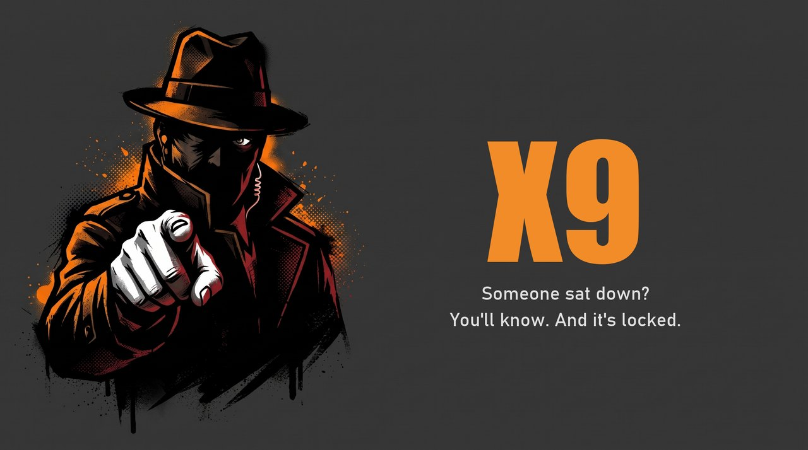

<p align="center">
  
</p>

<p align="center">
  <b>Webcam watchdog for your unattended Windows PC.</b><br>
  Someone sits down → your phone gets an alert → the PC locks itself.
</p>

<p align="center">
  <b>English</b> · <a href="README.pt-BR.md">Português</a>
</p>

<p align="center">
  <a href="https://github.com/acert99/X9/actions/workflows/tests.yml"></a>
  
  
</p>

> **Heads-up:** built by an enthusiast, not a professional developer,
> with AI assistance. It works for my personal use, but it has not had
> a formal security review. Read the code before trusting it with
> anything sensitive. Issues and PRs are welcome.

**Why "X9"?** In Brazilian slang, *X9* is a snitch: someone who tells
what they saw. That is this program's whole job.

## The problem

Sometimes I leave my laptop **on, open and unlocked** so I can reach it
later through remote access (AnyDesk, in my case). An unlocked machine
with nobody around is exposed: anyone walking by can sit down and use
it, and I would never know.

X9 watches the webcam while the machine is alone. When a person shows
up in front of it, X9:

1. **sends an alert to your phone** (ntfy, Telegram, Discord, Gotify,
   email… anything [Apprise](https://github.com/caronc/apprise) supports);
2. **locks Windows**, the same as pressing Win+L, so only someone with
   your password gets in.

You can still reach the lock screen remotely and unlock it yourself.

## Features

- 🧍 **Person detection** with YOLOX Nano, running 100% locally. No
  cloud, no images saved to disk.
- 🔒 **Auto-lock** (Win+L) on detection. Can be turned off.
- 📱 **Phone alerts** through Apprise, with a cooldown so you are not
  spammed.
- 📷 **Camera picker** in the tray menu. Works with virtual cameras
  such as **iVCam**, DroidCam and OBS Virtual Camera, so a phone can be
  the webcam on a desktop PC.
- 🖱️ **Manual only:** the camera turns on only when you click *Start
  monitoring* in the tray.
- 📦 **Windows installer** with Start Menu shortcut, optional autostart
  and uninstaller.

## Quick start (users)

1. Download and run **`X9Setup.exe`**.
2. On first launch, a small window asks for your notification URL.
   For ntfy: `ntfy://ntfy.sh/x9_<long_random_name>`. Install the ntfy
   app on your phone and subscribe to the same topic.
3. Right-click the tray icon → **Camera** → pick your camera.
4. Right-click the tray icon → **Start monitoring**. Then walk away.

> ⚠️ **Your ntfy topic name is a password.** On public `ntfy.sh` there is
> no per-topic authentication: anyone who knows the name can read your
> alerts and send fake ones. Use a long random name and never share it.
> See [Security & privacy](#security--privacy).

> ⚠️ **The lock only protects you if your Windows account has a
> password or PIN.**

## How it behaves

```
Start monitoring (tray)
   └─ camera opens
       └─ YOLOX checks each frame
           └─ person seen for a few seconds in a row?
               ├─ yes → phone alert + lock Windows + stop monitoring
               └─ no  → keep watching
```

After locking, **monitoring stops by itself**. Otherwise you, the owner,
would be detected and locked out again seconds after typing your
password. Click *Start monitoring* again when you leave.

With the lock turned **off**, X9 only sends alerts:

| Situation | Alert? |
|---|---|
| Someone sits down for the first time | Yes |
| The same person stays seated | No (cooldown, 10 min) |
| Nobody seen for 60 s, then someone arrives | **Yes** |
| Person steps out of frame for a few seconds | No |

## Settings

Stored in `%LOCALAPPDATA%\X9\config.yaml`. Full example:
[`config.yaml.example`](config.yaml.example).

| Key | Default | What it does |
|---|---|---|
| `security.lock_on_detection` | `true` | Lock Windows on detection, then stop monitoring |
| `camera.index` | `0` | Camera to use (easier: pick it in the tray menu) |
| `detector.confidence` | `0.60` | Minimum score to count as a person |
| `detector.positive_frames` | `5` | Positive frames needed inside `window_seconds` |
| `detector.absence_seconds` | `60` | Time with nobody around before the next arrival alerts again |
| `notification.cooldown_seconds` | `600` | Minimum gap between alerts |
| `notification.urls` | — | One or more [Apprise URLs](https://github.com/caronc/apprise/wiki) |

## Security & privacy

**These are design properties, not bugs.**

- **No images are stored.** Each frame is analyzed in memory and
  thrown away. Only "person yes/no" is used.
- **The ntfy topic is a secret.** See the warning above. For real
  authentication, self-host ntfy with access control or use Telegram or
  Gotify.
- **Credentials are plain text.** `config.yaml` is protected only by
  your Windows user account permissions. It is in `.gitignore` so it
  never lands in a commit.
- **The model is verified.** `scripts/download_model.py` only accepts
  the official YOLOX Nano file if its SHA-256 matches
  (`c789161e…bd18a0b7d`). Otherwise it deletes the file and fails.
- **Not encrypted end-to-end.** The push server sees the alert text.
- **Not anti-theft and not surveillance.** X9 does not know *who* is
  there. It is meant for **your own** machine. If other people use or
  pass by this computer, tell them, and check local laws on recording
  and monitoring.

## Building from source (developers)

Requires Windows and Python 3.12.

**One click:** double-click `INSTALAR.bat`. It creates the venv,
downloads the model, builds `dist\X9.exe` and, if
[Inno Setup](https://jrsoftware.org/isdl.php) is installed, builds
`dist_installer\X9Setup.exe`.

**Step by step:**

```powershell
python -m venv venv
venv\Scripts\activate
pip install -r requirements.txt
python scripts\download_model.py

copy config.yaml.example config.yaml   # then add your notification URL
python src\main.py                      # run from source

scripts\build_exe.bat                   # dist\X9.exe (uses X9.spec)
scripts\build_installer.bat             # dist_installer\X9Setup.exe
```

Check detection without a webcam:

```powershell
python scripts\check_detection.py path\to\photo.jpg
```

**Tests** (no webcam, network or GUI needed, and they never lock your
PC):

```powershell
pip install pytest
pytest tests/ -v
```

GitHub Actions runs them on every push and PR to `main`.

### Code map

Each module in `src/` does one thing and does not know about the others.

| Module | Job |
|---|---|
| `camera.py` | List, open, read and release cameras (DirectShow on Windows) |
| `detector.py` | Run YOLOX Nano and say if there is a person in the frame |
| `temporal_filter.py` | Confirm presence only after several positive frames |
| `notifier.py` | Send alerts through Apprise with cooldown |
| `locker.py` | Lock the Windows session (`LockWorkStation`) |
| `tray.py` | Tray icon and menu, including the camera picker |
| `config.py` | Load, validate and save `config.yaml` |
| `paths.py` | Resolve paths in script and executable mode |
| `setup_wizard.py` | First-run setup window |
| `main.py` | Wire everything together |

## Roadmap

- [x] Detection, alerts, cooldown, tray, installer
- [x] Auto-lock on detection
- [x] Camera picker (virtual cameras included)
- [ ] Optional snapshot attached to the alert
- [ ] Recognize authorized people
- [ ] Swappable models and plugins

## Credits

X9 exists thanks to these open source projects:

| Project | Used for | License |
|---|---|---|
| [YOLOX](https://github.com/Megvii-BaseDetection/YOLOX) (Megvii) | Detection model (YOLOX Nano, ONNX) | Apache 2.0 |
| [OpenCV](https://opencv.org/) | Camera capture and frame processing | Apache 2.0 |
| [ONNX Runtime](https://onnxruntime.ai/) | Model inference | MIT |
| [Apprise](https://github.com/caronc/apprise) | Notifications | BSD 2-Clause |
| [ntfy](https://ntfy.sh/) | Recommended push app | Apache 2.0 |
| [pystray](https://github.com/moses-palmer/pystray) | Tray icon and menu | LGPL-3.0+ / GPL-3.0+ |
| [pygrabber](https://github.com/andreaschiavinato/python_grabber) + [comtypes](https://github.com/enthought/comtypes) | Camera names via DirectShow | MIT |
| [Pillow](https://python-pillow.org/) | Tray icon drawing | MIT-CMU |
| [PyYAML](https://pyyaml.org/) | Config file | MIT |
| [NumPy](https://numpy.org/) | Image arrays | BSD 3-Clause |
| [PyInstaller](https://pyinstaller.org/) | `.exe` packaging | GPL-2.0+ with bootloader exception |
| [Inno Setup](https://jrsoftware.org/isinfo.php) | Installer | Inno Setup license (free) |

Missing or wrong credit? Open an issue or PR.

## License

MIT. See [`LICENSE`](LICENSE).
