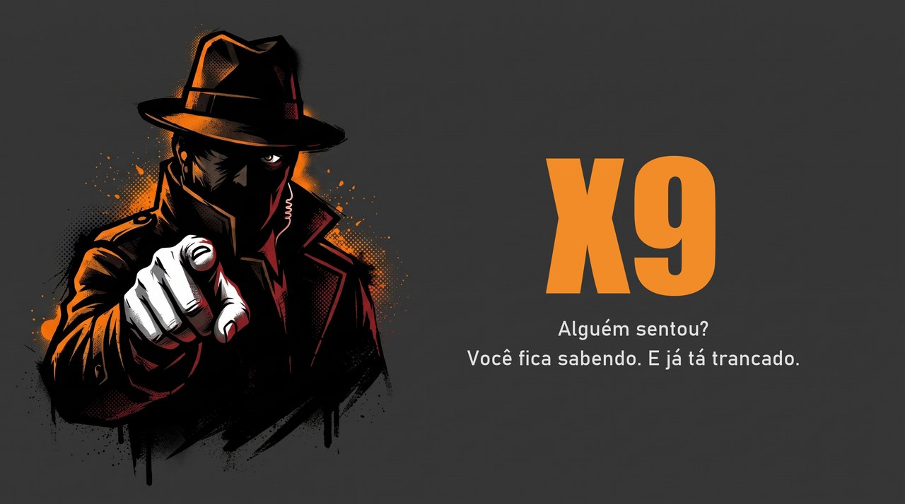

<p align="center">
  
</p>

<p align="center">
  <b>Vigia por webcam para o seu PC Windows desacompanhado.</b><br>
  Alguém sentou → alerta no celular → o PC se bloqueia sozinho.
</p>

<p align="center">
  <a href="README.md">English</a> · <b>Português</b>
</p>

<p align="center">
  <a href="https://github.com/acert99/X9/actions/workflows/tests.yml"></a>
  
  
</p>

> **Aviso:** feito por um entusiasta, não um desenvolvedor profissional,
> com ajuda de IA. Funciona no meu uso pessoal, mas não passou por
> revisão de segurança formal. Leia o código antes de confiar nele para
> algo sensível. Issues e PRs são bem-vindos.

**Por que "X9"?** Na gíria, *X9* é o dedo-duro: quem entrega o que viu.
É exatamente o trabalho deste programa.

## O problema

Às vezes eu deixo o notebook **ligado, aberto e desbloqueado** para
acessá-lo remotamente depois (pelo AnyDesk, no meu caso). Máquina
destravada e sem ninguém por perto fica exposta: qualquer um que passe
pode sentar e usar, e eu nunca saberia.

O X9 vigia pela webcam enquanto a máquina está sozinha. Quando aparece
uma pessoa na frente dela, o X9:

1. **manda um alerta para o seu celular** (ntfy, Telegram, Discord,
   Gotify, e-mail… tudo que o [Apprise](https://github.com/caronc/apprise) aceita);
2. **bloqueia o Windows**, igual a apertar Win+L, então só entra quem
   souber a sua senha.

Você continua conseguindo chegar na tela de bloqueio pelo acesso remoto
e desbloquear.

## Recursos

- 🧍 **Detecção de pessoas** com YOLOX Nano, 100% local. Sem nuvem e
  sem salvar imagem nenhuma em disco.
- 🔒 **Bloqueio automático** (Win+L) ao detectar. Dá para desligar.
- 🙂 **Pessoa confiável:** cadastre seu rosto e o X9 não bloqueia o PC
  quando for você. Mesmo assim ele te avisa, por garantia.
- 📱 **Alertas no celular** via Apprise, com cooldown para não lotar
  de notificação.
- 📷 **Escolha de câmera** no menu da bandeja. Funciona com câmeras
  virtuais como **iVCam**, DroidCam e OBS Virtual Camera, então o
  celular pode ser a webcam de um PC de mesa.
- 🖱️ **Só manual:** a câmera só liga quando você clica em *Iniciar
  monitoramento* na bandeja.
- 📦 **Instalador Windows** com atalho no Menu Iniciar, início
  automático opcional e desinstalador.

## Começo rápido (quem só vai usar)

1. Baixe e rode o **`X9Setup.exe`**.
2. Na primeira abertura, uma janelinha pede a URL de notificação. Para
   o ntfy: `ntfy://ntfy.sh/x9_<nome_longo_aleatorio>`. Instale o app
   ntfy no celular e inscreva-se no mesmo tópico.
3. Botão direito no ícone da bandeja → **Camera** → escolha a câmera.
4. *(Opcional)* Bandeja → **Pessoa confiavel** → **Cadastrar meu
   rosto pela camera**. Uma janela mostra a câmera e te guia por 7
   poses (de frente, os dois lados, queixo para cima e para baixo,
   perto e longe). Leva uns 1 minuto. Quanto mais poses, melhor o X9
   te reconhece.
5. Botão direito no ícone da bandeja → **Iniciar monitoramento**. Pode
   sair.

> ⚠️ **O nome do tópico do ntfy é uma senha.** No `ntfy.sh` público não
> existe autenticação por tópico: quem souber o nome lê seus alertas e
> pode mandar alertas falsos. Use um nome longo e aleatório e nunca
> compartilhe. Veja [Segurança e privacidade](#segurança-e-privacidade).

> ⚠️ **O bloqueio só protege se a sua conta do Windows tiver senha ou
> PIN.**

## Como ele se comporta

```
Iniciar monitoramento (bandeja)
   └─ câmera abre
       └─ YOLOX analisa cada frame
           └─ pessoa vista por alguns segundos seguidos?
               ├─ não → continua vigiando
               └─ sim → é um rosto cadastrado (confiável)?
                        ├─ sim → só alerta no celular, continua vigiando
                        └─ não / rosto não aparece → alerta + bloqueia + para
```

Depois de bloquear, **o monitoramento para sozinho**. Senão você, o
dono, seria detectado e bloqueado de novo segundos depois de digitar a
senha. Clique em *Iniciar monitoramento* de novo quando for sair.

Com o bloqueio **desligado**, o X9 só avisa:

| Situação | Alerta? |
|---|---|
| Alguém senta pela primeira vez | Sim |
| A mesma pessoa continua sentada | Não (cooldown de 10 min) |
| Ninguém por 60 s e depois alguém chega | **Sim** |
| A pessoa sai do enquadramento por alguns segundos | Não |

## Configurações

Ficam em `%LOCALAPPDATA%\X9\config.yaml`. Exemplo completo:
[`config.yaml.example`](config.yaml.example).

| Chave | Padrão | O que faz |
|---|---|---|
| `security.lock_on_detection` | `true` | Bloqueia o Windows ao detectar e para de vigiar |
| `security.trusted_face_threshold` | `0.45` | Exigência do reconhecimento (0 a 1). Mais alto = aceita menos estranhos, mas pode bloquear você |
| `security.trusted_face_frames` | `6` | Frames analisados antes de decidir. Um rosto desconhecido já basta para bloquear |
| `camera.index` | `0` | Câmera usada (mais fácil: escolher no menu da bandeja) |
| `detector.confidence` | `0.60` | Nota mínima para contar como pessoa |
| `detector.positive_frames` | `5` | Frames positivos necessários dentro de `window_seconds` |
| `detector.absence_seconds` | `60` | Tempo sem ninguém até a próxima chegada alertar de novo |
| `notification.cooldown_seconds` | `600` | Intervalo mínimo entre alertas |
| `notification.urls` | — | Uma ou mais [URLs do Apprise](https://github.com/caronc/apprise/wiki) |

## Segurança e privacidade

**São propriedades do desenho, não bugs.**

- **Nenhuma imagem é guardada.** Cada frame é analisado em memória e
  descartado. Só o resultado "tem pessoa sim/não" é usado.
- **O tópico do ntfy é segredo.** Veja o aviso acima. Para autenticação
  de verdade, hospede seu próprio ntfy com controle de acesso, ou use
  Telegram ou Gotify.
- **Credenciais ficam em texto puro.** O `config.yaml` é protegido só
  pelas permissões da sua conta do Windows. Ele está no `.gitignore`
  para nunca ir parar num commit.
- **Os modelos são verificados.** O `scripts/download_model.py` só
  aceita os arquivos oficiais do YOLOX Nano, YuNet e SFace se o SHA-256
  bater. Se não bater, apaga o arquivo e falha.
- **Rostos confiáveis ficam salvos como números, não como foto.** O
  cadastro guarda só uma "impressão digital" de 128 números do rosto em
  `%LOCALAPPDATA%\X9\trusted_faces.npy`. Não sai do seu PC, mas
  continua sendo dado biométrico: apague pelo menu da bandeja quando
  quiser.
- **Reconhecimento facial pode ser enganado por foto.** Não há
  detecção de pessoa viva, então alguém segurando uma foto sua pode
  passar por você. Por isso o X9 **sempre avisa**, mesmo quando
  reconhece um rosto confiável. Se o rosto não aparece (de costas,
  escuro), o X9 trata como estranho.
- **Sem criptografia de ponta a ponta.** O servidor de push vê o texto
  do alerta.
- **Não é antifurto nem vigilância.** O X9 não sabe *quem* está ali. É
  para a **sua própria** máquina. Se outras pessoas usam ou circulam
  perto desse computador, avise a elas e confira as leis locais sobre
  gravação e monitoramento.

## Gerar a partir do código (desenvolvedores)

Precisa de Windows e Python 3.12.

**Um clique:** dê dois cliques em `INSTALAR.bat`. Ele cria o venv,
baixa o modelo, gera o `dist\X9.exe` e, se o
[Inno Setup](https://jrsoftware.org/isdl.php) estiver instalado, gera o
`dist_installer\X9Setup.exe`.

**Passo a passo:**

```powershell
python -m venv venv
venv\Scripts\activate
pip install -r requirements.txt
python scripts\download_model.py

copy config.yaml.example config.yaml   # depois coloque sua URL de notificação
python src\main.py                      # roda direto do código

scripts\build_exe.bat                   # dist\X9.exe (usa o X9.spec)
scripts\build_installer.bat             # dist_installer\X9Setup.exe
```

Testar a detecção sem webcam:

```powershell
python scripts\check_detection.py caminho\para\foto.jpg
```

**Testes** (sem webcam, rede ou janela, e nunca bloqueiam o seu PC):

```powershell
pip install pytest
pytest tests/ -v
```

O GitHub Actions roda os testes em todo push e PR na `main`.

### Mapa do código

Cada módulo em `src/` faz uma coisa só e não conhece os outros.

| Módulo | Função |
|---|---|
| `camera.py` | Listar, abrir, ler e liberar câmeras (DirectShow no Windows) |
| `detector.py` | Rodar o YOLOX Nano e dizer se tem pessoa no frame |
| `temporal_filter.py` | Confirmar presença só depois de vários frames positivos |
| `notifier.py` | Mandar alertas via Apprise com cooldown |
| `locker.py` | Bloquear a sessão do Windows (`LockWorkStation`) |
| `face_auth.py` | Cadastrar e reconhecer rostos confiáveis (YuNet + SFace) |
| `enroll_guide.py` / `enroll_window.py` | Cadastro guiado: checagem de pose e janela com a câmera ao vivo |
| `tray.py` | Ícone e menu da bandeja, incluindo a escolha de câmera |
| `config.py` | Carregar, validar e salvar o `config.yaml` |
| `paths.py` | Resolver caminhos em modo script e em modo executável |
| `setup_wizard.py` | Janela de configuração da primeira execução |
| `main.py` | Ligar tudo |

## Roadmap

- [x] Detecção, alertas, cooldown, bandeja, instalador
- [x] Bloqueio automático ao detectar
- [x] Escolha de câmera (incluindo câmeras virtuais)
- [x] Reconhecer pessoas confiáveis pelo rosto
- [ ] Foto opcional anexada ao alerta
- [ ] Modelos e plugins intercambiáveis

## Créditos

O X9 existe graças a estes projetos open source:

| Projeto | Uso | Licença |
|---|---|---|
| [YOLOX](https://github.com/Megvii-BaseDetection/YOLOX) (Megvii) | Modelo de detecção (YOLOX Nano, ONNX) | Apache 2.0 |
| [OpenCV](https://opencv.org/) | Captura da câmera e processamento de frames | Apache 2.0 |
| [YuNet](https://github.com/opencv/opencv_zoo/tree/main/models/face_detection_yunet) (opencv_zoo) | Detecção de rostos | MIT |
| [SFace](https://github.com/opencv/opencv_zoo/tree/main/models/face_recognition_sface) (opencv_zoo) | Reconhecimento de rostos | Apache 2.0 |
| [ONNX Runtime](https://onnxruntime.ai/) | Inferência do modelo | MIT |
| [Apprise](https://github.com/caronc/apprise) | Notificações | BSD 2-Clause |
| [ntfy](https://ntfy.sh/) | App de push recomendado | Apache 2.0 |
| [pystray](https://github.com/moses-palmer/pystray) | Ícone e menu da bandeja | LGPL-3.0+ / GPL-3.0+ |
| [pygrabber](https://github.com/andreaschiavinato/python_grabber) + [comtypes](https://github.com/enthought/comtypes) | Nomes das câmeras via DirectShow | MIT |
| [Pillow](https://python-pillow.org/) | Desenho do ícone da bandeja | MIT-CMU |
| [PyYAML](https://pyyaml.org/) | Arquivo de configuração | MIT |
| [NumPy](https://numpy.org/) | Arrays de imagem | BSD 3-Clause |
| [PyInstaller](https://pyinstaller.org/) | Empacotamento do `.exe` | GPL-2.0+ com exceção do bootloader |
| [Inno Setup](https://jrsoftware.org/isinfo.php) | Instalador | Licença Inno Setup (gratuita) |

Faltou algum crédito ou está errado? Abra uma issue ou PR.

## Licença

MIT. Veja o [`LICENSE`](LICENSE).
